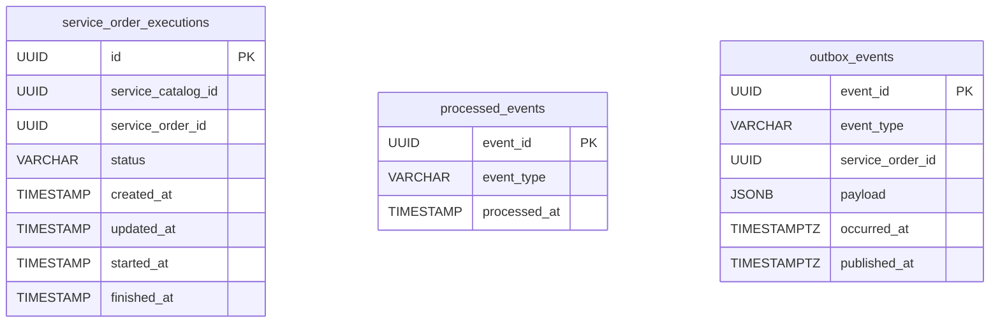

# Banco de Dados

O ms-ofisy-execution tem seu próprio banco **PostgreSQL 16** (`ms_ofisy_execution_db`), separado do banco do core. O schema é versionado com Flyway (ver [FLYWAY.md](FLYWAY.md)).

Localmente, o banco sobe pelo `compose.db.yaml` (ou `compose.yaml`) e fica exposto em `localhost:5433`, para não conflitar com o banco do core na porta 5432.

---

## Diagrama



As tabelas não se relacionam entre si.

---

## Tabelas

### `service_order_executions`

Uma linha por serviço do catálogo a ser executado dentro de uma ordem de serviço.

| Coluna               | Tipo          | Nulo | Descrição                                               |
|----------------------|---------------|------|---------------------------------------------------------|
| `id`                 | `UUID`        | não  | Chave primária, `gen_random_uuid()` por padrão          |
| `service_catalog_id` | `UUID`        | não  | Serviço do catálogo sendo executado                     |
| `service_order_id`   | `UUID`        | não  | Ordem de serviço à qual a execução pertence             |
| `status`             | `VARCHAR(50)` | não  | `PENDING`, `IN_PROGRESS`, `COMPLETED` ou `CANCELLED`    |
| `created_at`         | `TIMESTAMP`   | não  | Criação do registro                                     |
| `updated_at`         | `TIMESTAMP`   | não  | Última mudança de status                                |
| `started_at`         | `TIMESTAMP`   | sim  | Preenchido ao passar para `IN_PROGRESS`                 |
| `finished_at`        | `TIMESTAMP`   | sim  | Preenchido ao passar para `COMPLETED` ou `CANCELLED`    |

**Constraints**

| Nome                                        | Regra                                           | Motivo                                                                                                                                          |
|---------------------------------------------|-------------------------------------------------|-------------------------------------------------------------------------------------------------------------------------------------------------|
| `ck_service_order_executions_status`        | `status IN (...)`                               | Garante no banco os mesmos valores do enum `ServiceOrderExecutionStatus`                                                                        |
| `uq_service_order_executions_order_catalog` | `UNIQUE (service_order_id, service_catalog_id)` | Um serviço só é executado uma vez por OS. É a última barreira de idempotência do consumo de eventos ([MESSAGING.md](MESSAGING.md#idempotência)) |

**Índices**

| Nome                                              | Coluna               | Consulta atendida                    |
|---------------------------------------------------|----------------------|--------------------------------------|
| `idx_service_order_executions_service_catalog_id` | `service_catalog_id` | Busca por serviço e tempo médio      |
| `idx_service_order_executions_status`             | `status`             | Busca por status                     |
| `idx_service_order_executions_created_at`         | `created_at`         | Ordenação por data de criação        |

A busca por `service_order_id` usa o índice criado pela constraint `UNIQUE`, já que `service_order_id` é a primeira coluna dela.

**Sem chaves estrangeiras:** `service_order_id` e `service_catalog_id` referenciam dados que pertencem a outros microsserviços e bancos. A consistência entre eles é garantida pela saga, não pelo banco.

### `processed_events`

Registro dos eventos já processados, usado para descartar reentregas.

| Coluna         | Tipo           | Nulo | Descrição                                   |
|----------------|----------------|------|---------------------------------------------|
| `event_id`     | `UUID`         | não  | Chave primária, o `eventId` do envelope     |
| `event_type`   | `VARCHAR(100)` | não  | Tipo do evento (`QuoteApproved`, ...)       |
| `processed_at` | `TIMESTAMP`    | não  | Momento do processamento                    |

O registro é gravado na mesma transação que cria as execuções. Se o processamento falhar, nenhum dos dois é persistido e o evento pode ser reprocessado.

### `outbox_events`

Eventos produzidos por este ms, aguardando ou já publicados no SNS ([MESSAGING.md](MESSAGING.md#publicação-de-eventos-outbox)).

| Coluna             | Tipo           | Nulo | Descrição                                                  |
|--------------------|----------------|------|------------------------------------------------------------|
| `event_id`         | `UUID`         | não  | Chave primária, vira o `eventId` do envelope               |
| `event_type`       | `VARCHAR(100)` | não  | Tipo do evento                                             |
| `service_order_id` | `UUID`         | não  | Ordem de serviço do evento, usada como `message-group-id`  |
| `payload`          | `JSONB`        | não  | Dados específicos do tipo de evento                        |
| `occurred_at`      | `TIMESTAMPTZ`  | não  | Momento do evento, define a ordem de publicação            |
| `published_at`     | `TIMESTAMPTZ`  | sim  | Preenchido quando o evento é publicado no SNS              |

As datas usam `TIMESTAMPTZ` porque o `occurredAt` do envelope é um `Instant`.

**Índices**

| Nome                        | Coluna        | Consulta atendida                                                            |
|-----------------------------|---------------|------------------------------------------------------------------------------|
| `idx_outbox_events_pending` | `occurred_at` | Busca dos pendentes pelo publicador. Parcial (`WHERE published_at IS NULL`), então não cresce com os já publicados |

---

## Migrations

| Versão | Arquivo                                           | Conteúdo                                                   |
|--------|---------------------------------------------------|------------------------------------------------------------|
| V1     | `V1__create_service_order_executions_table.sql`   | Tabela `service_order_executions`, constraints e índices   |
| V2     | `V2__insert_service_order_executions_data.sql`    | Massa de dados com 12 execuções em 6 ordens de serviço     |
| V3     | `V3__create_processed_events_table.sql`           | Tabela `processed_events`                                  |
| V4     | `V4__create_outbox_events_table.sql`              | Tabela `outbox_events` e índice dos pendentes              |

A massa de dados (V2) usa os mesmos IDs de ordens de serviço e de catálogo das migrations de seed do core (`V15`, `V16` e `V17`), para facilitar testes ponta a ponta.

## Consultas úteis

```bash
make db-executions SERVICE_ORDER_ID=c3d4e5f6-a7b8-9012-cdef-123456780001
make db-processed-events
make db-outbox
```