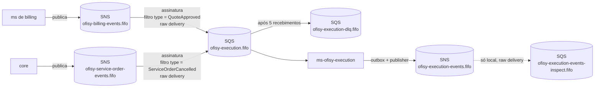
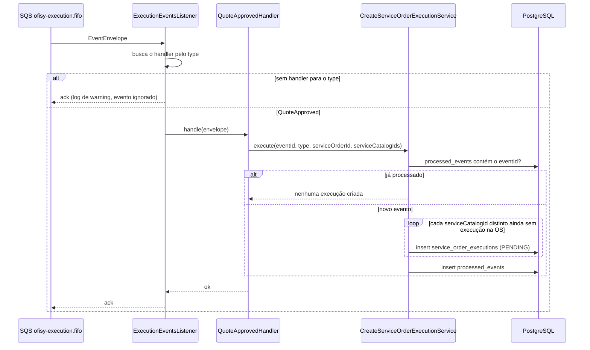
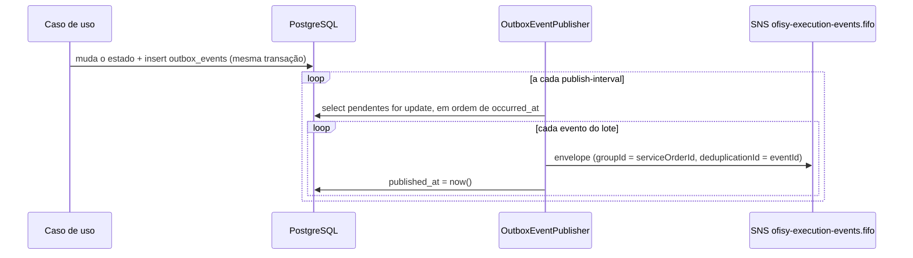

# Mensageria

O ms-ofisy-execution se comunica com os demais microsserviços por eventos, usando **Amazon SNS + SQS** ([ADR-0011](https://github.com/15SOAT-FIAP/techchallenge-ofisy/blob/master/docs/adr/0011-utilizar-sns-e-sqs-como-mensageria.md)). Cada produtor publica no seu próprio tópico, e este ms recebe os eventos que lhe interessam por uma única fila FIFO. Os eventos que ele produz saem por um *transactional outbox* para o tópico `ofisy-execution-events.fifo`.

---

## Topologia



| Recurso          | Nome                                  | Observação                                                                                                   |
|------------------|---------------------------------------|--------------------------------------------------------------------------------------------------------------|
| Tópico           | `ofisy-billing-events.fifo`           | Pertence ao ms de billing na AWS. Localmente é criado só para exercitar o fluxo                              |
| Tópico           | `ofisy-service-order-events.fifo`     | Eventos da OS, publicados pelo core na AWS. Localmente é criado só para exercitar o fluxo                    |
| Assinaturas      | tópicos → fila                        | Uma por tópico, com `RawMessageDelivery=true` e `FilterPolicy` aplicada ao corpo da mensagem (`MessageBody`) |
| Fila             | `ofisy-execution.fifo`                | Configurada em `ofisy.messaging.queues.execution` (`application.yaml`)                                       |
| DLQ              | `ofisy-execution-dlq.fifo`            | `RedrivePolicy` com `maxReceiveCount=5`                                                                      |
| Tópico           | `ofisy-execution-events.fifo`         | Tópico deste ms, configurado em `ofisy.messaging.topics.execution`                                           |
| Fila de inspeção | `ofisy-execution-events-inspect.fifo` | Só local. Assinada no tópico deste ms para ver o que foi publicado                                           |

Localmente, tudo é criado pelo `localstack/init/ready.d/01-messaging.sh`, que roda quando o LocalStack sobe. Com `queue-not-found-strategy: fail`, a aplicação não inicia se a fila não existir.

Na AWS, os recursos vêm do repositório de infraestrutura. O tópico é configurado pelo **nome**: o `SnsConfig` registra um `TopicsListingTopicArnResolver`, que descobre o ARN listando os tópicos (`sns:ListTopics`) em vez de chamar `CreateTopic`, e guarda o resultado em cache. A aplicação precisa de `sns:ListTopics` e `sns:Publish`.

---

## Contrato dos eventos

Todo evento segue o mesmo envelope (`adapters/listeners/dto/EventEnvelope.java`). O `payload` varia conforme o `type`:

| Campo            | Tipo      | Descrição                                                    |
|------------------|-----------|--------------------------------------------------------------|
| `eventId`        | UUID      | Identificador único do evento, usado para idempotência       |
| `type`           | String    | Tipo do evento, usado no filtro da assinatura e no despacho  |
| `serviceOrderId` | UUID      | Ordem de serviço à qual o evento se refere                   |
| `occurredAt`     | Instant   | Momento em que o evento ocorreu no produtor                  |
| `payload`        | JSON      | Dados específicos do tipo de evento                          |

### Eventos consumidos

| Evento                  | Produtor      | Efeito                                                                                    |
|-------------------------|---------------|-------------------------------------------------------------------------------------------|
| `QuoteApproved`         | ms de billing | Cria uma execução `PENDING` para cada `serviceCatalogId` dos itens do orçamento           |
| `ServiceOrderCancelled` | core          | Cancela as execuções `PENDING` e `IN_PROGRESS` da OS. As `COMPLETED` continuam como estão |

#### `QuoteApproved`

```json
{
  "eventId": "3f1c2a9e-8d4b-4b7a-9c1e-2f6d5a7b8c90",
  "type": "QuoteApproved",
  "serviceOrderId": "c3d4e5f6-a7b8-9012-cdef-123456780001",
  "occurredAt": "2026-10-13T10:00:00Z",
  "payload": {
    "quoteId": "7a8b9c0d-1e2f-4a3b-8c4d-5e6f7a8b9c0d",
    "serviceItems": [
      { "serviceCatalogId": "b1c2d3e4-f5a6-7890-bcde-f12345678901" },
      { "serviceCatalogId": "b1c2d3e4-f5a6-7890-bcde-f12345678902" }
    ]
  }
}
```

#### `ServiceOrderCancelled`

Segue a mesma regra do core: ao cancelar a OS, o `CancelServiceOrderService` chama o `CancelPendingExecutionsUseCase`, que cancela todas as execuções ativas (`PENDING` e `IN_PROGRESS`) e preserva as já concluídas. Aqui o mesmo caso de uso é acionado pelo evento, via `ServiceOrderCancelledHandler`, e publica um [`AllExecutionsCancelled`](#allexecutionscancelled).

O payload é vazio: o cancelamento só precisa do `serviceOrderId`, que já vem no envelope.

```json
{
  "eventId": "5e6f7a8b-9c0d-4e1f-8a2b-3c4d5e6f7a8b",
  "type": "ServiceOrderCancelled",
  "serviceOrderId": "c3d4e5f6-a7b8-9012-cdef-123456780001",
  "occurredAt": "2026-10-20T10:00:00Z",
  "payload": {}
}
```

### Eventos publicados

Todos saem pelo outbox, descrito em [Publicação de eventos](#publicação-de-eventos-outbox).

| Evento                   | Quando é publicado                                                                                      | Quem reage                                                 |
|--------------------------|---------------------------------------------------------------------------------------------------------|------------------------------------------------------------|
| `ExecutionStarted`       | Ao iniciar a **primeira** execução de uma OS (`PATCH /{id}/start`)                                      | Core: move a OS de `AWAITING_EXECUTION` para `IN_PROGRESS` |
| `AllExecutionsCompleted` | Ao concluir a **última** execução pendente de uma OS, sem contar as canceladas (`PATCH /{id}/complete`) | Core: move a OS de `IN_PROGRESS` para `FINISHED`           |
| `AllExecutionsCancelled` | Ao processar um `ServiceOrderCancelled`, salvo se a OS já foi concluída                                 | Ms de estoque: devolve os itens consumidos na OS           |

#### `ExecutionStarted`

No core, o início de uma execução só muda o status da OS quando ela ainda está em `AWAITING_EXECUTION`, ou seja, no início da primeira execução. O ms reproduz essa regra sem conhecer o status da OS: o evento sai apenas se **nenhuma execução da OS tem `startedAt` preenchido** antes deste início. Uma execução iniciada e depois cancelada mantém o `startedAt`, então um novo início não publica o evento outra vez, assim como o core não volta a mudar a OS.

O payload é vazio: o core só precisa do `serviceOrderId`, que já vem no envelope.

```json
{
  "eventId": "9b2f6c1e-4a7d-4e8b-a1c3-5d6e7f8a9b0c",
  "type": "ExecutionStarted",
  "serviceOrderId": "c3d4e5f6-a7b8-9012-cdef-123456780001",
  "occurredAt": "2026-10-17T13:00:00.123456Z",
  "payload": {}
}
```

**Concorrência:** dois inícios simultâneos de execuções da mesma OS podem gravar dois `ExecutionStarted`. Não há efeito duplicado, porque o core só faz a transição a partir de `AWAITING_EXECUTION` e ignora o segundo evento.

#### `AllExecutionsCompleted`

Depois de concluir uma execução, se **nenhuma** execução da OS está `PENDING` ou `IN_PROGRESS` (ou seja, todas estão `COMPLETED` ou `CANCELLED`), o evento é gravado no outbox na mesma transação. Sempre existe pelo menos uma concluída, a que acabou de ser concluída. O payload é vazio, como no `ExecutionStarted`.

```json
{
  "eventId": "1c2d3e4f-5a6b-4c7d-8e9f-0a1b2c3d4e5f",
  "type": "AllExecutionsCompleted",
  "serviceOrderId": "c3d4e5f6-a7b8-9012-cdef-123456780001",
  "occurredAt": "2026-10-17T15:00:00.123456Z",
  "payload": {}
}
```

**Execução cancelada:** aqui a regra diverge do core de propósito. No core, uma execução `CANCELLED` impede a OS de chegar a "todas concluídas", e a OS fica parada para sempre. Neste ms, as execuções são canceladas por eventos (por exemplo, serviços retirados do orçamento), então elas não contam para a regra. Uma OS que só tem execuções canceladas nunca passa por aqui, porque nenhuma execução é concluída.

**Concorrência:** sem cuidado, as duas últimas execuções concluídas ao mesmo tempo não enxergariam uma à outra, nenhuma publicaria o evento e a OS ficaria parada (o core tem esse risco). Por isso, a conclusão trava todas as execuções da OS com `SELECT ... FOR UPDATE` (`lockAllFromSameServiceOrder`, ordenado por `id` para evitar deadlock) antes de verificar a regra. As conclusões de uma mesma OS são serializadas, e a última sempre vê as anteriores e publica um único evento.

#### `AllExecutionsCancelled`

Depois de cancelar as execuções `PENDING` e `IN_PROGRESS` da OS, o `CancelPendingExecutionsService` grava o evento no outbox na mesma transação do cancelamento e do registro em `processed_events`. O payload é vazio, como nos demais.

O evento sai sempre que um `ServiceOrderCancelled` novo é processado, com uma exceção: se a OS não tem execução ativa e tem pelo menos uma `COMPLETED`, ela já foi concluída e o `AllExecutionsCompleted` já saiu. Isso acontece quando o core cancela a OS antes de consumir o `AllExecutionsCompleted`. Nesse caso o evento não é gravado, para o estoque não devolver itens de serviços realizados. O `eventId` é registrado em `processed_events` do mesmo jeito.

Uma OS sem nenhuma execução (cancelada antes do `QuoteApproved`) ou só com execuções canceladas continua publicando o evento, mesmo sem nada para cancelar, para a saga seguir e a OS não ficar presa.

```json
{
  "eventId": "7d8e9f0a-1b2c-4d3e-9f4a-5b6c7d8e9f0a",
  "type": "AllExecutionsCancelled",
  "serviceOrderId": "c3d4e5f6-a7b8-9012-cdef-123456780001",
  "occurredAt": "2026-10-20T10:00:01.123456Z",
  "payload": {}
}
```

**Idempotência:** um `ServiceOrderCancelled` reentregue é descartado pelo `processed_events` antes de chegar aqui, então não gera um segundo `AllExecutionsCancelled`. Se o cancelamento de alguma execução falhar, a transação é desfeita e o evento não é gravado.

**Concorrência:** sem cuidado, um cancelamento e a conclusão da última execução ativa da OS ao mesmo tempo gravariam `AllExecutionsCompleted` e `AllExecutionsCancelled` para a mesma OS, e o cancelamento ainda sobrescreveria a execução concluída. Por isso, o cancelamento trava as execuções ativas com `SELECT ... FOR UPDATE` (`lockByServiceOrderIdAndStatusIn`, ordenado por `id`, como a conclusão, para evitar deadlock). Se a conclusão vier primeiro, o cancelamento espera e, ao reavaliar o filtro de status, já não encontra a execução concluída. Se o cancelamento vier primeiro, a conclusão espera e recusa a transição de `CANCELLED` para `COMPLETED`.

---

## Fluxo de processamento



O diagrama mostra o `QuoteApproved`. O `ServiceOrderCancelled` segue o mesmo caminho: o `ServiceOrderCancelledHandler` chama o `CancelPendingExecutionsService`, que confere o `processed_events`, cancela as execuções ativas, grava o `AllExecutionsCancelled` no outbox e registra o `eventId` em `processed_events`, tudo na mesma transação.

O `ExecutionEventsListener` não conhece os eventos: ele recebe todos os `EventHandler` registrados no Spring e despacha pelo `type`. Cada tipo de evento tem seu próprio handler em `adapters/listeners/handlers/`.

### Ordenação

As mensagens são publicadas com `message-group-id = serviceOrderId`. Assim, eventos de uma mesma OS são processados em ordem, e OSs diferentes são processadas em paralelo.

### Idempotência

A entrega do SQS é *at-least-once*, então um mesmo evento pode chegar mais de uma vez (por exemplo, reentrega fora da janela de deduplicação de 5 minutos da fila FIFO). Todo evento consumido é registrado em **`processed_events`** na mesma transação do seu efeito. Se o `eventId` já existir, o evento é descartado sem efeito.

No `QuoteApproved`, a proteção tem mais duas camadas:

1. **Checagem por OS + serviço**: antes de criar cada execução, o caso de uso verifica se já existe uma para o par `serviceOrderId` + `serviceCatalogId`. Também remove IDs de catálogo duplicados do payload.
2. **Constraint `UNIQUE (service_order_id, service_catalog_id)`**: última barreira no banco ([DATABASE.md](DATABASE.md)).

### Falhas e DLQ

- **Tipo sem handler**: o evento é logado como ignorado e confirmado, sem passar pelo banco. Na prática isso só acontece se a `FilterPolicy` deixar passar um tipo que ainda não tem handler.
- **Mensagem inválida ou erro no processamento**: a exceção impede o ack, a mensagem volta para a fila depois do *visibility timeout* e, depois de 5 recebimentos, vai para a DLQ.

---

## Como adicionar um novo evento consumido

1. Criar o DTO do payload em `adapters/listeners/dto/`.
2. Criar um `@Component` em `adapters/listeners/handlers/` implementando `EventHandler`, com `type()` retornando o nome do evento.
3. Incluir o tipo na `FilterPolicy` da assinatura em `localstack/init/ready.d/01-messaging.sh` (e na infraestrutura da AWS). Se o evento vier de outro produtor, criar a assinatura no tópico correspondente.
4. Cobrir com teste unitário do handler e, se fizer sentido, com um cenário no `ExecutionEventsListenerIT`.
5. Adicionar a linha na tabela de [eventos consumidos](#eventos-consumidos) deste documento.

---

## Publicação de eventos (outbox)

Nenhum caso de uso publica direto no SNS. Seguindo a [RFC-0008](https://github.com/15SOAT-FIAP/techchallenge-ofisy/blob/master/docs/rfc/0008-coordenar-a-saga-entre-os-microsservicos.md), o caso de uso grava o evento na tabela `outbox_events`, na mesma transação da mudança de estado, e um publicador agendado o envia ao tópico. Se a transação falhar, o evento não é gravado; se o SNS estiver fora, o evento espera no banco.



| Peça                                          | Papel                                                                  |
|-----------------------------------------------|------------------------------------------------------------------------|
| `domain/OutboxEvent`                          | O evento a publicar: tipo, OS e payload. Id e `occurredAt` são gerados |
| `domain/OutboxEventRepository`                | Porta usada pelos casos de uso. Só tem `save`                          |
| `adapters/gateways/OutboxEventRepositoryImpl` | Serializa o payload para JSON e grava em `outbox_events` junto com o contexto do trace atual |
| `adapters/publishers/OutboxEventPublisher`    | Lê os pendentes, publica o envelope no SNS dentro do trace de origem e marca `published_at` |
| `adapters/tracing/TraceContextPropagator`     | Captura e restaura o contexto do trace pela API do OpenTelemetry       |

O envelope publicado é o mesmo `EventEnvelope` que este ms consome, então quem assina o tópico recebe o mesmo contrato descrito em [Contrato dos eventos](#contrato-dos-eventos).

### Rastreamento distribuído pelo outbox

O publicador roda em um job agendado, e o `dd-java-agent` abre um trace novo a cada execução dele. Sem tratamento, a publicação no SNS ficaria nesse trace do job e o fluxo de uma OS apareceria quebrado no Datadog, separado da requisição (ou do consumo de mensagem) que gerou o evento.

Para manter o fluxo em um único trace:

1. Ao gravar o evento, o `OutboxEventRepositoryImpl` captura o contexto do trace ativo (`traceparent` e `x-datadog-*`) e o guarda na coluna `trace_context`.
2. Ao publicar, o `OutboxEventPublisher` restaura esse contexto e cria o span `outbox.publish` como filho do trace de origem, com os atributos `ofisy.event.id`, `ofisy.event.type`, `ofisy.service_order.id` e `messaging.destination.name`.
3. Com o span de origem ativo, a instrumentação do SNS do `dd-java-agent` injeta o trace nos atributos da mensagem, para que o consumidor do outro ms continue o mesmo trace.

O contexto viaja nos atributos da mensagem, não no envelope, então o contrato dos eventos não muda. A captura usa a API do OpenTelemetry, que o `dd-java-agent` conecta aos spans do Datadog quando `DD_TRACE_OTEL_ENABLED=true` (definido em `k8s/configmap.yml`). Sem o agent, como em ambiente local e nos testes, a API é no-op: nada é capturado e o evento é publicado normalmente. Um `trace_context` ilegível também não impede a publicação, só perde a ligação com o trace de origem.

### Garantias

- **Ordem**: os pendentes são publicados em ordem de `occurred_at`, com `message-group-id = serviceOrderId`. Quando um evento falha, o publicador loga e **pula os eventos seguintes da mesma OS** naquele lote, para não publicá-los fora de ordem. Os eventos das outras OSs continuam sendo publicados normalmente. O evento que falhou é tentado de novo no próximo ciclo.
- **Evento que sempre falha**: um evento com falha permanente (por exemplo, payload inválido) é tentado a cada ciclo e segura os eventos seguintes da sua OS, mas não bloqueia as outras OSs. Ainda não há limite de tentativas nem status de erro.
- **Mais de uma réplica**: a busca dos pendentes usa `SELECT ... FOR UPDATE`. Uma segunda réplica espera o lote da primeira terminar e já encontra os eventos marcados, sem publicar fora de ordem.
- **Duplicidade**: se a aplicação cair entre publicar e gravar `published_at`, o evento é publicado de novo. Dentro da janela de 5 minutos, a deduplicação FIFO (`deduplicationId = eventId`) descarta a cópia; depois disso, os consumidores precisam ser idempotentes pelo `eventId`.
- **Retenção**: os eventos publicados continuam na tabela, com `published_at` preenchido. Ainda não há limpeza automática.

### Configuração

| Propriedade                               | Padrão                        | Descrição                                               |
|-------------------------------------------|-------------------------------|---------------------------------------------------------|
| `ofisy.messaging.topics.execution`        | `ofisy-execution-events.fifo` | Nome do tópico onde os eventos saem                     |
| `ofisy.messaging.outbox.publish-interval` | `1s`                          | Intervalo entre o fim de um ciclo e o início do próximo |
| `ofisy.messaging.outbox.batch-size`       | `100`                         | Máximo de eventos publicados por ciclo                  |

### Como publicar um novo evento

1. Criar um `record` com o payload do evento.
2. No caso de uso, dentro da transação que muda o estado, chamar `outboxEventRepository.save(OutboxEvent.create("NomeDoEvento", serviceOrderId, payload))`.
3. Cobrir no teste do caso de uso que o evento é gravado e adicionar a linha na tabela de [eventos publicados](#eventos-publicados) deste documento.

---

## Exercitando o fluxo localmente

Com o ambiente de desenvolvimento no ar (`make dev-up` + `make run`):

| Comando                              | O que faz                                                                                                          |
|--------------------------------------|--------------------------------------------------------------------------------------------------------------------|
| `make event-quote-approved`          | Publica um `QuoteApproved` no tópico. Aceita `EVENT_ID`, `SERVICE_ORDER_ID` e `CATALOG_IDS` (separados por espaço) |
| `make event-service-order-cancelled` | Publica um `ServiceOrderCancelled` no tópico de OS. Exige `SERVICE_ORDER_ID` e aceita `EVENT_ID`                   |
| `make event-ignored`                 | Publica um `QuoteRejected`, que a `FilterPolicy` descarta antes de chegar na fila                                  |
| `make event-invalid`                 | Envia uma mensagem inválida direto na fila, que vai para a DLQ após 5 tentativas (~2,5 min)                        |
| `make queue-status`                  | Mostra as mensagens visíveis e em processamento na fila e na DLQ                                                   |
| `make dlq-peek`                      | Lista as mensagens da DLQ sem removê-las                                                                           |
| `make dlq-redrive`                   | Devolve as mensagens da DLQ para a fila principal                                                                  |
| `make dlq-purge`                     | Apaga todas as mensagens da DLQ                                                                                    |
| `make db-executions`                 | Lista as execuções de uma OS (`SERVICE_ORDER_ID` obrigatório)                                                      |
| `make db-processed-events`           | Lista os últimos eventos processados                                                                               |
| `make db-outbox`                     | Lista os últimos eventos do outbox e se já foram publicados                                                        |
| `make events-peek`                   | Lista os eventos publicados no tópico deste ms, pela fila de inspeção                                              |

### Exemplo: verificando a idempotência

```bash
make event-quote-approved
# o script imprime o comando para reenviar o mesmo evento, por exemplo:
make event-quote-approved EVENT_ID=<id> SERVICE_ORDER_ID=<os> CATALOG_IDS="<c1> <c2>"

make db-executions SERVICE_ORDER_ID=<os>   # continua com 2 execuções
make db-processed-events                   # o eventId aparece uma única vez
```

> **Atenção ao `dlq-redrive`:** a mensagem volta com o mesmo *deduplication id*. Se o envio original tiver menos de 5 minutos, a fila FIFO a descarta como duplicada.