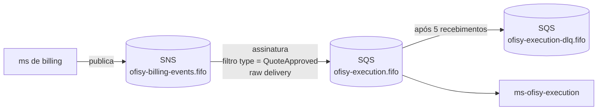
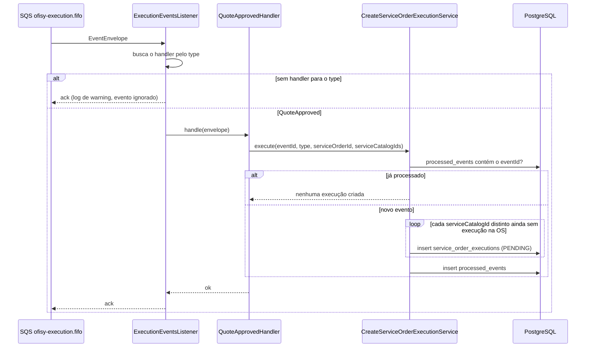

# Mensageria

O ms-ofisy-execution se comunica com os demais microsserviços por eventos, usando **Amazon SNS + SQS** ([ADR-0011](https://github.com/15SOAT-FIAP/techchallenge-ofisy/blob/master/docs/adr/0011-utilizar-sns-e-sqs-como-mensageria.md)). Cada produtor publica no seu próprio tópico, e este ms recebe os eventos que lhe interessam por uma única fila FIFO.

---

## Topologia



| Recurso    | Nome                        | Observação                                                                               |
|------------|-----------------------------|------------------------------------------------------------------------------------------|
| Tópico     | `ofisy-billing-events.fifo` | Pertence ao ms de billing na AWS. Localmente é criado só para exercitar o fluxo          |
| Assinatura | tópico → fila               | `RawMessageDelivery=true` e `FilterPolicy` aplicada ao corpo da mensagem (`MessageBody`) |
| Fila       | `ofisy-execution.fifo`      | Configurada em `ofisy.messaging.queues.execution` (`application.yaml`)                   |
| DLQ        | `ofisy-execution-dlq.fifo`  | `RedrivePolicy` com `maxReceiveCount=5`                                                  |

Localmente, tudo é criado pelo `localstack/init/ready.d/01-messaging.sh`, que roda quando o LocalStack sobe. Com `queue-not-found-strategy: fail`, a aplicação não inicia se a fila não existir.

---

## Contrato dos eventos

Todo evento segue o mesmo envelope (`adapters/listeners/dto/EventEnvelope.java`). O `payload` varia conforme o `type`:

| Campo            | Tipo      | Descrição                                                    |
|------------------|-----------|--------------------------------------------------------------|
| `eventId`        | UUID      | Identificador único do evento, usado para idempotência       |
| `type`           | String    | Tipo do evento, usado no filtro da assinatura e no despacho  |
| `serviceOrderId` | UUID      | Ordem de serviço à qual o evento se refere                   |
| `occurredAt`     | Instant   | Momento em que o evento ocorreu no produtor                  |
| `payload`        | JSON      | Dados específicos do tipo de evento                          |

### Eventos consumidos

| Evento          | Produtor       | Efeito                                                                           |
|-----------------|----------------|----------------------------------------------------------------------------------|
| `QuoteApproved` | ms de billing  | Cria uma execução `PENDING` para cada `serviceCatalogId` dos itens do orçamento  |

#### `QuoteApproved`

```json
{
  "eventId": "3f1c2a9e-8d4b-4b7a-9c1e-2f6d5a7b8c90",
  "type": "QuoteApproved",
  "serviceOrderId": "c3d4e5f6-a7b8-9012-cdef-123456780001",
  "occurredAt": "2026-10-13T10:00:00Z",
  "payload": {
    "quoteId": "7a8b9c0d-1e2f-4a3b-8c4d-5e6f7a8b9c0d",
    "serviceItems": [
      { "serviceCatalogId": "b1c2d3e4-f5a6-7890-bcde-f12345678901" },
      { "serviceCatalogId": "b1c2d3e4-f5a6-7890-bcde-f12345678902" }
    ]
  }
}
```

### Eventos publicados

Nenhum por enquanto.

---

## Fluxo de processamento



O `ExecutionEventsListener` não conhece os eventos: ele recebe todos os `EventHandler` registrados no Spring e despacha pelo `type`. Cada tipo de evento tem seu próprio handler em `adapters/listeners/handlers/`.

### Ordenação

As mensagens são publicadas com `message-group-id = serviceOrderId`. Assim, eventos de uma mesma OS são processados em ordem, e OSs diferentes são processadas em paralelo.

### Idempotência

A entrega do SQS é *at-least-once*, então um mesmo evento pode chegar mais de uma vez (por exemplo, reentrega fora da janela de deduplicação de 5 minutos da fila FIFO). A proteção tem três camadas:

1. **`processed_events`**: o `eventId` é registrado na mesma transação que cria as execuções. Se já existir, o evento é descartado.
2. **Checagem por OS + serviço**: antes de criar cada execução, o caso de uso verifica se já existe uma para o par `serviceOrderId` + `serviceCatalogId`. Também remove IDs de catálogo duplicados do payload.
3. **Constraint `UNIQUE (service_order_id, service_catalog_id)`**: última barreira no banco ([DATABASE.md](DATABASE.md)).

### Falhas e DLQ

- **Tipo sem handler**: o evento é logado como ignorado e confirmado, sem passar pelo banco. Na prática isso só acontece se a `FilterPolicy` deixar passar um tipo que ainda não tem handler.
- **Mensagem inválida ou erro no processamento**: a exceção impede o ack, a mensagem volta para a fila depois do *visibility timeout* e, depois de 5 recebimentos, vai para a DLQ.

---

## Como adicionar um novo evento consumido

1. Criar o DTO do payload em `adapters/listeners/dto/`.
2. Criar um `@Component` em `adapters/listeners/handlers/` implementando `EventHandler`, com `type()` retornando o nome do evento.
3. Incluir o tipo na `FilterPolicy` da assinatura em `localstack/init/ready.d/01-messaging.sh` (e na infraestrutura da AWS). Se o evento vier de outro produtor, criar a assinatura no tópico correspondente.
4. Cobrir com teste unitário do handler e, se fizer sentido, com um cenário no `ExecutionEventsListenerIT`.
5. Adicionar a linha na tabela de [eventos consumidos](#eventos-consumidos) deste documento.

---

## Exercitando o fluxo localmente

Com o ambiente de desenvolvimento no ar (`make dev-up` + `make run`):

| Comando                     | O que faz                                                                                                          |
|-----------------------------|--------------------------------------------------------------------------------------------------------------------|
| `make event-quote-approved` | Publica um `QuoteApproved` no tópico. Aceita `EVENT_ID`, `SERVICE_ORDER_ID` e `CATALOG_IDS` (separados por espaço) |
| `make event-ignored`        | Publica um `QuoteRejected`, que a `FilterPolicy` descarta antes de chegar na fila                                  |
| `make event-invalid`        | Envia uma mensagem inválida direto na fila, que vai para a DLQ após 5 tentativas (~2,5 min)                        |
| `make queue-status`         | Mostra as mensagens visíveis e em processamento na fila e na DLQ                                                   |
| `make dlq-peek`             | Lista as mensagens da DLQ sem removê-las                                                                           |
| `make dlq-redrive`          | Devolve as mensagens da DLQ para a fila principal                                                                  |
| `make dlq-purge`            | Apaga todas as mensagens da DLQ                                                                                    |
| `make db-executions`        | Lista as execuções de uma OS (`SERVICE_ORDER_ID` obrigatório)                                                      |
| `make db-processed-events`  | Lista os últimos eventos processados                                                                               |

### Exemplo: verificando a idempotência

```bash
make event-quote-approved
# o script imprime o comando para reenviar o mesmo evento, por exemplo:
make event-quote-approved EVENT_ID=<id> SERVICE_ORDER_ID=<os> CATALOG_IDS="<c1> <c2>"

make db-executions SERVICE_ORDER_ID=<os>   # continua com 2 execuções
make db-processed-events                   # o eventId aparece uma única vez
```

> **Atenção ao `dlq-redrive`:** a mensagem volta com o mesmo *deduplication id*. Se o envio original tiver menos de 5 minutos, a fila FIFO a descarta como duplicada.